# Spectre Mnemonic for core 0.4

A supervised Elixir memory engine with an explicit AgentServer integration:
search and recall evidence during cognition; write through an admitted host operation when
the application requires consent. The existing standalone Engine 0.2 APIs,
text retrieval, embeddings, graph search and persistence remain
available. Core 0.4 does not change the satellite's independent version number.

[Documentation index](docs/INDEX.md) · [Migrate from core 0.3](docs/MIGRATING_TO_SPECTRE_0_4.md)



[Diagram source](docs/assets/readme-architecture.mmd).

The Stack runtime owns the Engine. The host supplies the authenticated memory
partition; reads and admitted writes use that same identity.

## Installation

Add the packages to your application:

```elixir
defp deps do
  [
    {:spectre, "~> 0.4.0"},
    {:spectre_mnemonic, "~> 0.2.0"}
  ]
end
```

For sibling checkouts, replace these with `path: "../spectre"` and
`path: "../spectre_mnemonic"` dependencies. Package integration tests use
`SPECTRE_PATH=../spectre mix test`.

Spectre remains optional for standalone `SpectreMnemonic` use. Supervise an
explicit `SpectreMnemonic.Engine` when calling those APIs directly; see the
[standalone guide](docs/STANDALONE.md).

## Explicit memory in Stack → Agent → Server

```elixir
defmodule MyApp.MemoryAI do
  use Spectre.Stack
  install Spectre.Mnemonic, automatic: false, bind: [remember: :save_note] do
    isolate_by([:subject])
  end
end

defmodule MyApp.MemoryServer do
  use Spectre.Server, tools: MyApp.MemoryAI

  def handle_flow({:notes, :recall}, input, ctx),
    do: mnemonic(ctx, {:recall, input.text}, on_result: :recalled)

  def handle_flow({:notes, :remember}, input, ctx),
    do: mnemonic(ctx, {:remember, input.text}, on_result: :saved)

  def handle_result(:recalled, {:ok, packet}, ctx),
    do: respond(ctx, Enum.map_join(packet.moments, "\n", &Map.get(&1, :text, "[locked memory]")))

  def handle_result(:saved, {:governed, %{outcome: %{status: :succeeded}}}, ctx),
    do: respond(ctx, "The note was saved.")

  def handle_result(tag, result, ctx), do: super(tag, result, ctx)
end

defmodule MyApp.MemoryAgent do
  use Spectre.Agent, stack: MyApp.MemoryAI, server: MyApp.MemoryServer
  flow :notes do
    on(:remember, regex: ~r/^remember /i)
    on(:recall, regex: ~r/^recall /i)
  end
end
```

`mnemonic/3` is generated from `tools/1`; the package does not export a helper
that you should import. `automatic: false` removes the automatic recall/persist
port while retaining the Engine resource and explicit tools. This prevents
implicit ingestion before your save-consent flow. The compatibility default is
`automatic: true`; changing it requires reviewing the application's behavior.

## Engine ownership, partition and consent

Supervise `Spectre.Stack.Runtime` with a **stable name**, then supply that name
to the Server; Spectre passes it to the admitted effect adapter:

```elixir
children = [
  {Spectre.Stack.Runtime,
   stack: MyApp.MemoryAI, name: MyApp.MemoryRuntime,
   packages: [mnemonic: [data_root: "var/memory", namespace: "notes"]]}
]
```

Start the Server after supervising the Stack runtime. Supply the authenticated
account identifier from your host:

```elixir
{:ok, server} = Spectre.Server.start_link(
  agent: MyApp.MemoryAgent,
  stack_runtime: MyApp.MemoryRuntime,
  identity: %{subject: account_id},
  consumer: self(),
  gam: [operations: %{save_note: [confirm: true]}])

{:ok, interaction} = Spectre.Server.input(server, "recall release notes")
```

The bound `:save_note` operation is enabled here with confirmation. Spectre
freezes the authenticated partition and runs the registered executor after admission.
The model cannot select its own partition. See the
[partition guide](docs/MIGRATING_TO_SPECTRE_0_4.md#authenticated-partition).

Use the **block DSL** `isolate_by([:subject])`; it is not an installation keyword
option. Missing `stack_runtime` or required subject fails closed. Explicit tools
do not fall back to the compatibility DefaultEngine. Multiple Engines can run
in one VM, but one durable `storage_id` must have only one writer across nodes.

## More memory operations

Use `{:search, cue, limit: 5}` for ranked hits, `{:recall, cue}` for a context
packet and `{:reflect, cue}` for source-linked evidence. Put memory options inside
the operation tuple and Server options such as `on_result:` outside it.
See the [AgentServer memory guide](docs/AGENT_SERVER.md) for all reads, bound writes,
portable results and recovery. Reads do not reinforce memory or reveal secrets.

## Memory capabilities and documentation

- [AgentServer reads, writes and results](docs/AGENT_SERVER.md)
- [Direct memory APIs and workflows](docs/STANDALONE.md)
- [Writing, embeddings, graphs and secrets](docs/MEMORY_GUIDE.md)
- [Retrieval and knowledge](docs/RETRIEVAL_AND_KNOWLEDGE.md)
- [Persistence, operations and erasure](docs/PERSISTENCE_AND_OPERATIONS.md)
- [Public API contract](docs/PUBLIC_API.md)
- [Engine 0.2 migration](docs/MIGRATING_TO_0_2.md)
- [Historical Instance integration](docs/LEGACY_0_3.md)

## Runtime and examples

The generated `mnemonic` helper also works in [Skill Server callbacks](https://github.com/elchemista/spectre/blob/0.4.0/docs/SKILLS.md).
Skills share the root's GAM Domain; enable governed operations on the root and
allow them in the mount's `governed:` references. The
[core tool guide](https://github.com/elchemista/spectre/blob/0.4.0/docs/STACK_TOOLS.md) covers scheduling and recovery;
[Managed GAM](https://github.com/elchemista/spectre/blob/0.4.0/docs/MANAGED_GAM.md) covers consent and registered execution.

See the [LiveView demo](https://github.com/elchemista/demo_spectre) for an application,
the [Spectre guides](https://spectre.guide) for articles, and the
[release audit](https://github.com/elchemista/spectre/blob/0.4.0/docs/RELEASE_0_4.md) for verified revisions.
